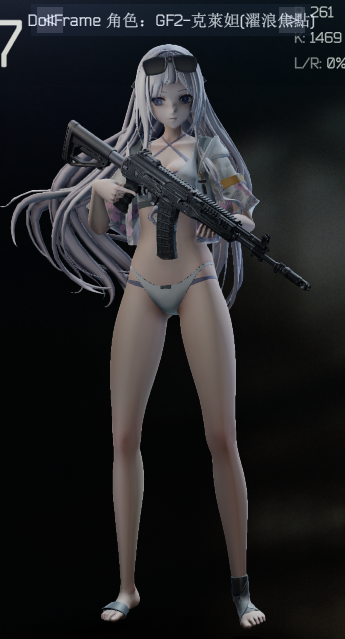

<p align="center">
  
</p>

<h1 align="center">DollFrame</h1>

<p align="center">
  <strong>SPTarkov 向けモジュール式 PMX キャラクター置換フレームワーク — PMX フォルダ直読み、独立リグ、2ボーン腕IK、PBR/SDF シェーディング、揺れ物物理＆ボイス置換。</strong>
</p>

<p align="center">
  <a href="README.md">English</a> |
  <a href="README.zh-TW.md">繁體中文</a> |
  <a href="README.ja.md">日本語</a>
</p>

---

## バッジ

<p align="center">
  
  
  
  
</p>

---

## 概要と設計思想

**DollFrame** は [SPTarkov](https://www.sp-tarkov.com/) 向けの BepInEx クライアント MOD です。専用アーカイブへのパッキングを行わず、**PMX（MMD）2.0** キャラクターフォルダ（`.pmx`＋テクスチャ）を実行時に直接読み込み、プレイヤーの `Root_Joint` 配下に独立したスキン済みリグを構築します。毎フレームバニラのアニメーション姿勢をミラーリングしつつ、2ボーン IK によって腕を武器グリップへ正確に追従させ、`.wav` ボイス置換・揺れ物物理演算・カスタム PBR/SDF シェーダー・非破壊装備非表示を提供します。また、SPT サーバーコンソールにロード情報のみを表示する任意のサーバーコンパニオン（`DollFrame.Server.dll`）も同梱されています。

### 設計思想

- **デフォルト非干渉**：`Replace player body` の初期値は `false` です。オフ時はレイド／ハイドアウトのプレイヤーへ一切の書き込みを行わず、メインメニューの 3D プレビューやトレーディングカードアイコンのみが動作します。
- **バニラスケルトン非侵襲**：`SkeletonRootJoint` や `SkeletonHands` のトランスフォームを変更せず、カメラや ADS 視点も上書きしません。
- **ゼロストレッチ契約**：毎フレーム書き込むのは `localRotation` のみ（スケーリングはリグ構築時にルートへ 1 度だけ脚部基準の均一倍率 `k` を適用）。

---

## 主な機能

- **PMX 2.0 フォルダ直読み＆均一スケーリング**：`.pmx` を含むキャラクターフォルダを直接読み込み、ロード時に頭部／胴体メッシュを自動分割。脚部比率に基づく均一スケーリングと移動用カプセル補正を適用し、LRU キャッシュ（既定 4 体）で切替負荷を軽減します。
- **2ボーン腕 IK＆指スナップ**：胸郭 SDF によるめり込み防止、`< 0.05 cm` の手首グリップ収束、段階的な指カールスナップにより、武器のグリップやハンドガードへ自然に指先を密着させます。
- **自然な非武装時の腕ポーズ**：武器非所持時は自然な肘の曲がり、手首のわずかな内傾、小指側へ強まる自然な指の開き、歩行に連動した腕振りを適用。死亡／ラグドール時は純 FK ミラーへ自動フォールバックします。
- **ボイス置換＆音量ノーマライズ**：`BaseSpeaker.Init` / `ReplaceVoice` をフックしてキャラクター対応の `.wav` ボイス（`Voices/<ファミリー名>/<トリガー名>/`）を自動適用し、`Vanilla (PMC)` 選択時はバニラ音声を復元。RMS ラウドネス正規化＋ソフトクリッピングにより、小音量のボイスも銃声に埋もれず明瞭に再生されます。
- **揺れ物物理演算**：髪・スカート・リボン・上着・胸のゼロストレッチ物理演算と全身カプセル衝突判定（前髪は固定）。
- **カスタム PBR / SDF レンダリング**：`dollframe_shaders.bundle` の `DollFrame/CharacterPBR` シェーダー（未導入時は Unity `Standard` へフォールバック）により、環境適応リムライト、布地・ストッキングのシアー光沢、SDF 顔陰影、一人称視点時の頭部自動 `ShadowsOnly` 化を実現。
- **8部位の装備ビジュアル非表示＆アクセサリ除外**：アーマー、リグ、バックパック、ヘルメット、フェイスマスク、アイウェア、ヘッドセット、アームバンド（`Dress` スキン装備を含む）および収納中武器をステータス無変更のまま非表示化。武器切替時は即座に同期し構えた武器が隠れる不具合を防ぐほか、PMX 内蔵の銃器・バッグマテリアルも自動除外します。
- **ゲーム内メニュー UI**：キャラクターの「**Overall（全般）**」画面に `DollFrame` ◀ ▶ セレクターを追加（再起動なしで新規 `.pmx` フォルダを即時認識）。メインメニュー 3D プレビューとトレーディングカードアイコン描画にも対応。

---

## スクリーンショット



---

## 動作要件

- **[SPTarkov](https://www.sp-tarkov.com/)**: `~4.1.6`
- **BepInEx 5 + 0Harmony**: SPTarkov に同梱
- **.NET SDK** *（ソースからビルドする場合のみ）*: `.NET Standard 2.1`（クライアント）／`.NET 8.0+`（サーバーコンパニオン）

---

## インストール方法

1. リリースファイルをダウンロード、またはソースからビルドします。
2. SPTarkov ディレクトリ内の所定パスへ配置します：

| 内容 | 配置先パス |
|---|---|
| `DollFrame.dll` + `dollframe_shaders.bundle` | `BepInEx/plugins/DollFrame/` |
| キャラクターフォルダ（`<キャラ名>/*.pmx`＋テクスチャ） | `BepInEx/plugins/DollFrame/Characters/` |
| ボイスパック（`<ファミリー名>/<トリガー>/*.wav`） | `BepInEx/plugins/DollFrame/Voices/` |
| サーバーコンパニオン（`DollFrame.Server.dll`・任意） | `user/mods/DollFrame/` |

3. ゲームを起動し、メインメニューの **Character → Overall** 画面にある `DollFrame` 行からキャラクターを選択します。レイド／ハイドアウトでモデルを適用する場合は、**F12** の設定画面から `Visual → Replace player body` を有効にしてください。

---

## 設定項目とデフォルト値

設定ファイル：`BepInEx/config/DollFrame.cfg`（ゲーム内で **F12** から編集可能）。

### Scaling / Capsule（スケーリング・カプセル）

| キー | 初期値 | 説明 |
|---|---|---|
| `Apply to own player` | `true` | 自プレイヤーのスケルトンにスケーリングを適用します。 |
| `Height multiplier` | `1.0` | モデル身長からカプセルを算出する際の倍率（`0` でバニラ PMC 値へ復元）。 |
| `Scale capsule` | `true` | モデルの身長に合わせて `CharacterController` / `CapsuleCollider` の高さ・中心を補正します。 |

### Visual（ビジュアル・物理）

| キー | 初期値 | 説明 |
|---|---|---|
| `Replace player body` | `false` | レイド／ハイドアウトでキャラクター置換を有効化（`false` 時は一切書き込みません）。 |
| `Character` | *(自動)* | 選択中のキャラクターフォルダ名（F12 では非表示、**Overall** 画面から変更）。 |
| `PMX unit scale` | `0.078` | 1 PMX 単位あたりのメートル換算値（MMD 基準 `1u ≈ 8 cm`）。 |
| `Model Y offset (m)` | `0` | モデルが浮く／沈む場合の垂直オフセット補正。 |
| `Max texture size` | `2048` | 読み込み時にこの解像度を超えるテクスチャを縮小し VRAM を節約します。 |
| `Hide model accessories` | `true` | PMX モデルに内蔵された銃器・バッグ等のマテリアルを非表示にします。 |
| `Hide accessories name filter` | `gun, glock, bag, butt, weapon, silencer` | 非表示対象アクセサリを判定する大文字小文字不問の部分一致フィルタ。 |
| `Model facing yaw (deg)` | `180` | プレイヤー正面に対するモデル向き補正（`-Z` 向きの PMX は `180` で正面）。 |
| `Idle cache size` | `4`（`2–24`） | 解析済みキャラクターの LRU キャッシュ上限。大きいほど切替が滑らかですが VRAM を消費します。 |
| `Replace player voice` | `true` | 対応ボイスパックを自動適用し、`Vanilla (PMC)` 時はバニラ音声へ戻します。 |
| `Enable secondary physics` | `true` | 髪・スカート・リボン・上着・胸の揺れ物物理とカプセル衝突を有効化します。 |
| `Enable rim light` | `true` | 環境適応リムライトと布地のシアー光沢を有効化します。 |
| `Rim light intensity` | `0.65`（`0–2.5`） | リムライト強度の全体倍率（`0` で無効）。 |
| `Rim light sharpness` | `3.2`（`0.8–8.0`） | 輪郭側へのリムライト収束の鋭さ。 |
| `Rim light tint` | `(0.85, 0.93, 1.0, 1.0)` | リムライトの全体カラーティント。 |

### Equipment（装備非表示・全 8 項目 初期値 `true`）

| キー | 初期値 | 説明 |
|---|---|---|
| `Hide armor on replaced bodies` | `true` | アーマーの外見を非表示にします（メニュー／レイド／FP／カード）。 |
| `Hide tactical rig on replaced bodies` | `true` | タクティカルリグの外見を非表示にします。 |
| `Hide backpack on replaced bodies` | `true` | バックパックの外見を非表示にします。 |
| `Hide headwear on replaced bodies` | `true` | ヘルメット／ヘッドギア（`Dress` 装備含む）を非表示にします。 |
| `Hide face cover on replaced bodies` | `true` | フェイスカバー／マスクを非表示にします。 |
| `Hide eyewear on replaced bodies` | `true` | アイウェアを非表示にします。 |
| `Hide earpiece on replaced bodies` | `true` | ヘッドセット／イヤーピースを非表示にします。 |
| `Hide armband on replaced bodies` | `true` | アームバンドを非表示にします。 |

---

## キャラクターパッケージ構成

- **キャラクターフォルダ（`*.pmx`）**：PMX 2.0 モデルとテクスチャ一式をキャラクターごとのサブフォルダ `BepInEx/plugins/DollFrame/Characters/<キャラクター名>/`（または `DollFrame_Characters/`）へ配置します。`BepInEx/plugins/` 配下の他プラグインフォルダ内にある `Characters/`、`DollFrame_Characters/`、`Voices/`、`DollFrame_Voices/` も自動スキャンされるため、独立したコンテンツパックとしての管理にも対応しています。
- **ボイスパック（`*.wav`）**：`Voices/<ファミリー名>/<EPhraseTrigger>/*.wav`（例：`OnFight/`、`NeedMedkit/`、`OnBeingHurt/`）の構造で 16-bit PCM または 32-bit float `.wav` を配置します。最長前方一致により、`AK12_Skin` のようなフォルダ名でも `Voices/AK12/` を自動参照します。

---

## トラブルシューティング

| 症状 | 対処方法 |
|---|---|
| Overall 行にキャラクターが表示されない | サブフォルダ内に `.pmx` ファイルが含まれており、`BepInEx/plugins/DollFrame/Characters/`（またはコンテンツパック側フォルダ）に配置されているか確認してください。 |
| モデルが浮く／地面に沈む | `Visual → Model Y offset (m)` で高さを微調整してください。 |
| キャラクター切替時にカクつく | `Visual → Idle cache size` を増やすとキャッシュ保持数が増えます。 |
| VRAM 使用量が高い | `Visual → Max texture size`（例：`1024`）や `Idle cache size` を下げてください。 |
| カスタムボイスが鳴らない | `Voices/<ファミリー名>/<EPhraseTrigger>/*.wav` 構成と `Replace player voice` の有効化を確認してください。 |
| リムライト等のシェーダーが効かない | `DollFrame.dll` と同じフォルダに `dollframe_shaders.bundle` があるか確認してください。 |
| ログでの診断 | `BepInEx/LogOutput.log` 内の `[DollFrame]` 行を確認してください。 |

---

## アーキテクチャ

```text
Plugin.cs                      # BepInEx エントリ、26項目の設定、フォルダ走査、Harmony 登録
├── Character/
│   ├── PmxRuntime.cs          # PMX 2.0 パーサー、テクスチャ読込、PmxAssets LRU キャッシュ
│   ├── MeshSplitter.cs        # 読込時の頭部／胴体メッシュ分割
│   ├── CharacterRig.cs        # リグ構築＆毎フレーム Drive（localRotation のみ書込）
│   ├── GameBones.cs           # ゲーム側ボーンアンカー解決（レイド＆プレビュー共通）
│   ├── BoneContract.cs        # PureDelta / PureRel ボーン契約と指ボーン定義
│   ├── ModelMetrics.cs / ModelScaler.cs  # 骨格計測と均一スケーリング
│   ├── Kinematics/            # 純粋数学：TwoBoneIk, ArmGrabIk, ArmRest, RigAim, SpringPhysics
│   ├── ShaderManager.cs / SdfFaceShading.cs  # シェーダーバンドル読込、リムライト、顔 SDF
│   ├── VoiceReplacer.cs       # WAV 読込、RMS ラウドネス正規化、BaseSpeaker フック
│   ├── Camera/FirstPersonSMRMask.cs          # 一人称時の頭部 ShadowsOnly 制御
│   └── BodyReplacer.cs / Patches.cs / CapsulePatches.cs / IkRefresh.cs
├── Visibility/                # バニラ素体非表示、8部位装備非表示（Dress 対応）、アクセサリ除外、Vanilla 判定
├── MenuUI/                    # Overall 切替UI、メインメニュー 3D プレビュー、カードアイコン描画
├── Shaders/                   # ビルド済み dollframe_shaders.bundle
└── ServerMod/                 # 任意の SPT サーバー情報表示コンパニオン
```

---

## 開発・ビルド

1. `UserSettings.props` の `SPTTarkovDirectory` にゲームディレクトリを設定します。
2. ビルドコマンド：

```bash
# ビルド検証のみ（ゲームフォルダへコピーしない／0 警告・0 エラー）
dotnet build -c Release -p:CopyOutputToBepInEx=false

# ビルド＆BepInEx/plugins/DollFrame/ へ自動デプロイ
dotnet build -c Release

# 任意のサーバーコンパニオンをビルド
dotnet build ServerMod/DollFrame.Server.csproj -c Release
```

---

## ロードマップ

- [x] **v0.4.0–0.4.1**：ハイドアウト床すり抜け修正、全モジュールライフサイクル／メモリリーク対策、ヘルメット／ヘッドセット／マスク非表示修正、武器切替時の一時非表示バグ修正、`< 0.05 cm` 握り精度＆指先スナップ、非武装時腕ポーズの自然化、ボイス RMS 音量正規化＆設定項目の整理。
- [ ] **今後の予定**：キャラクター別の個別ボイス音量／ピッチプリセット、フレーズトリガー別名の拡充、追加のスタイルシェーダープリセット。

---

## クレジット＆ライセンス

- **作者**: `kukki`
- **使用技術**: [SPTarkov](https://www.sp-tarkov.com/), [BepInEx](https://github.com/BepInEx/BepInEx), [Harmony](https://github.com/pardeike/Harmony)
- **関連ドキュメント**: [`CHANGELOG.md`](CHANGELOG.md) · [`AGENTS.md`](AGENTS.md)
- **ライセンス**: **All rights reserved** © `kukki`（[`ServerMod/ModMetadata.cs`](ServerMod/ModMetadata.cs) 参照）。
