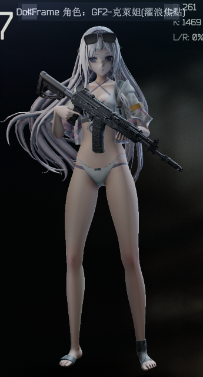

<p align="center">
  
</p>
<p align="center">
  <sub>Project avatar / emblem features <strong>AK-12</strong> from <em>Girls' Frontline</em>.</sub>
</p>

<h1 align="center">DollFrame</h1>

<p align="center">
  <strong>Modular PMX Character Replacement Framework for Single Player Tushonka — Direct PMX Folder Loading, Independent Rig, Two-Bone Arm IK, PBR/SDF Shading, Secondary Physics &amp; Voice Replacement.</strong>
</p>

<p align="center">
  <a href="README.md">English</a> |
  <a href="README.zh-TW.md">繁體中文</a> |
  <a href="README.ja.md">日本語</a>
</p>

---

## Badges

<p align="center">
  
  
  
  
</p>

---

## Overview

**DollFrame** is a BepInEx client-side framework for [Single Player Tushonka](https://www.sp-tarkov.com/) that directly loads custom **PMX (MMD)** 2.0 character folders (`.pmx` + textures) at runtime without requiring proprietary archive packing. For each character, DollFrame constructs an independent skinned rig under the player's `Root_Joint`, mirrors the vanilla animation pose every frame, retargets arms onto in-game weapons with a two-bone IK solver, and provides automatic `.wav` voice replacement, secondary spring physics, custom PBR/SDF shaders, and non-destructive equipment hiding. An optional lightweight server companion (`DollFrame.Server.dll`) is included solely to display load metadata on the SPT server console.

### Design Philosophy

- **Non-Intrusive by Default**: `Replace player body` defaults to `false`. While off, DollFrame performs zero writes to the in-raid/hideout player, while main menu 3D preview and trading card icons remain active.
- **Zero Writes to Vanilla Skeleton**: Never mutates `SkeletonRootJoint` or `SkeletonHands` transforms, and never overrides the camera or ADS view.
- **Zero-Stretch Contract**: Every frame writes only `localRotation` (with uniform leg-anchored scale `k` applied once at rig root during `Build`).

---

## Features

- **Direct PMX 2.0 Folder Loading & Scaling**: Scans unpacked character folders containing `.pmx` models, splits body/head meshes at load time, applies leg-anchored uniform proportion scaling with capsule height/center compensation, and caches parsed assets in an LRU cache (default 4 models).
- **Two-Bone Arm IK & Finger Snapping**: Retargets upper arm and forearm to in-game palm anchors with chest SDF anti-clipping, `< 0.05 cm` wrist grip convergence, and progressive finger curl snapping so fingertips wrap cleanly around weapon grips.
- **Natural Unarmed Arm Pose**: Relaxed elbow bend, gentle wrist cup, graduated open-hand finger curl, and gait-coupled arm swing when unarmed; automatically falls back to pure FK mirroring on death/ragdoll.
- **Voice Replacement & Loudness Normalization**: Hooks `BaseSpeaker.Init` / `ReplaceVoice` to load `.wav` voice banks (`Voices/<Family>/<Trigger>/`) matching the selected character and restores vanilla PMC voices when switching back to `Vanilla (PMC)`. Built-in RMS loudness normalization with soft-clipping prevents quiet voice packs from being drowned out by gunfire.
- **Secondary Physics**: Zero-stretch spring physics for hair, skirts, ribbons, coat tails, and bust with body-capsule collision (bangs stay fixed).
- **Custom PBR / SDF Rendering**: `DollFrame/CharacterPBR` shaders (`dollframe_shaders.bundle`, with Unity `Standard` fallback) featuring environment-adaptive rim lighting, fabric/stocking sheen, SDF facial shading, and automatic `ShadowsOnly` head masking in first-person.
- **8-Slot Equipment Visual Hiding & Accessory Filtering**: Hides vanilla armor, tactical rig, backpack, headwear, face cover, eyewear, earpiece, and armband (including `Dress`-skinned headgear) plus holstered weapons without altering actual item stats, with immediate weapon-switch sync so active weapons are never hidden. Also filters out built-in PMX weapon/bag materials.
- **In-Game Menu UI**: `DollFrame:` ◀ ▶ selector row on the **Overall** character screen (hot-rescans new `.pmx` folders without restarting), main menu 3D preview, and custom trading card icon rendering.

---

## Screenshots



---

## Requirements

- **[Single Player Tushonka](https://www.sp-tarkov.com/)**: `~4.1.6`
- **BepInEx 5 + 0Harmony**: Bundled with Single Player Tushonka
- **.NET SDK** *(only required if building from source)*: `.NET Standard 2.1` (client) / `.NET 8.0+` (server companion)

---

## Installation

1. Download or build the release package.
2. Copy the client files into your Single Player Tushonka directory:

| Component | Target Path in Single Player Tushonka Directory |
|---|---|
| `DollFrame.dll` + `dollframe_shaders.bundle` | `BepInEx/plugins/DollFrame/` |
| Character folders (`<Name>/*.pmx` + textures) | `BepInEx/plugins/DollFrame/Characters/` |
| Voice packs (`<Family>/<Trigger>/*.wav`) | `BepInEx/plugins/DollFrame/Voices/` |
| Server companion (`DollFrame.Server.dll`, optional) | `user/mods/DollFrame/` |

3. Launch the game, open **Character → Overall** in the main menu to pick a character using the `DollFrame` row, and enable `Visual → Replace player body` in **F12** (Configuration Manager) when you want the replacement active in raids and hideout.

### Directory Structure

```text
<SPTarkov>/
├── BepInEx/plugins/DollFrame/
│   ├── DollFrame.dll
│   ├── dollframe_shaders.bundle
│   ├── Characters/                      # Or DollFrame_Characters/ (also scanned in sibling plugin folders)
│   │   └── <CharacterName>/
│   │       ├── <model>.pmx              # PMX 2.0 model
│   │       ├── sdf_face.png             # Optional baked facial SDF map
│   │       └── Textures/                # Model textures
│   └── Voices/                          # Or DollFrame_Voices/ (also scanned in sibling plugin folders)
│       └── <CharacterFamily>/
│           ├── OnFight/*.wav            # 16-bit PCM or 32-bit float .wav
│           ├── NeedMedkit/*.wav
│           └── ...                      # Named after EFT EPhraseTrigger or USEC/BEAR bank aliases
└── user/mods/DollFrame/
    └── DollFrame.Server.dll             # Optional server metadata companion
```

### `Characters` Skeleton Naming Rules (PMX / MMD)

DollFrame maps standard Japanese MMD bone names (`BoneContract`) to the EFT skeleton. All **21 core bones** below are required for a character to attach cleanly:

| Region | Required Bone Names (PMX Japanese) |
|---|---|
| **Pelvis / Spine / Head** | `下半身`, `上半身`, `上半身2`, `首`, `頭` *(optional root aliases: `腰`, `センター`)* |
| **Left Arm** | `左肩`, `左腕`, `左ひじ`, `左手首` |
| **Right Arm** | `右肩`, `右腕`, `右ひじ`, `右手首` |
| **Left Leg** | `左足`, `左ひざ`, `左足首`, `左足首先` |
| **Right Leg** | `右足`, `右ひざ`, `右足首`, `右足首先` |

- **Optional 30 Finger Bones** (for weapon grip snapping & relaxed open-hand poses):
  - Thumb: `左親指０` / `１` / `２`, `右親指０` / `１` / `２`
  - Index: `左人指１` / `２` / `３`, `右人指１` / `２` / `３`
  - Middle: `左中指１` / `２` / `３`, `右中指１` / `２` / `３`
  - Ring: `左薬指１` / `２` / `３`, `右薬指１` / `２` / `３`
  - Pinky: `左小指１` / `２` / `３`, `右小指１` / `２` / `３`
- **Secondary Physics & Extra Bones**: Any unlisted descendant bones (hair, skirt, ribbon, coat, bust) remain parented to their authored bone and are automatically driven by `SpringPhysics`.

### `Voices` Naming & Matching Rules

- **Folder Mapping**: Exact character folder name is checked first (`Voices/<CharacterName>/`), followed by **longest-prefix matching** (e.g. `GF2-克萊妲(濯浪焦點)` automatically resolves to `Voices/GF2-克萊妲/`).
- **Trigger Subfolders**: Name subfolders after EFT `EPhraseTrigger` values (e.g. `OnFight`, `OnBeingHurt`, `NeedMedkit`, `OnEnemyDown`, `GetInCover`, `Reload`, `Greetings`) or standard USEC/BEAR bank aliases (`Fight`, `BrokenHand`, `BrokenLeg`, `Cooperation`, `Attention`, etc.).

---

## Configuration

Config file: `BepInEx/config/DollFrame.cfg` (editable in-game via **F12**).

### Scaling & Capsule

| Key | Default | Description |
|---|---|---|
| `Apply to own player` | `true` | Apply scaling to your own player skeleton. |
| `Height multiplier` | `1.0` | Multiplier on the model's authored height when deriving the capsule (`0` restores the vanilla PMC capsule). |
| `Scale capsule` | `true` | Compensates `CharacterController` / `CapsuleCollider` height and center to match the scaled model height. |

### Visual

| Key | Default | Description |
|---|---|---|
| `Replace player body` | `false` | Replace the player body in raids/hideout. When `false`, zero writes are performed on the raid player. |
| `Character` | *(auto)* | Selected character folder name (hidden in F12; switch via the menu **Overall** screen). |
| `PMX unit scale` | `0.078` | Meters per PMX unit (MMD convention: `1u ≈ 8 cm`). |
| `Model Y offset (m)` | `0` | Vertical offset correction if a model floats or sinks slightly. |
| `Max texture size` | `2048` | Textures exceeding this dimension are downscaled on load to save VRAM. |
| `Hide model accessories` | `true` | Hide built-in weapons/bags authored inside the PMX model. |
| `Hide accessories name filter` | `gun, glock, bag, butt, weapon, silencer` | Case-insensitive substrings used to identify accessory materials/textures to hide. |
| `Model facing yaw (deg)` | `180` | Yaw rotation relative to player forward (`180` aligns `-Z`-facing PMX models forward). |
| `Idle cache size` | `4` (`2–24`) | LRU cache capacity for parsed character assets. Higher values reduce switch stutter at the cost of VRAM. |
| `Replace player voice` | `true` | Automatically load matching character voices and restore vanilla PMC voice when set to `Vanilla (PMC)`. |
| `Enable secondary physics` | `true` | Enable spring physics for hair, skirts, ribbons, coats, and bust with body-capsule collision. |
| `Enable rim light` | `true` | Enable environment-adaptive rim lighting and fabric sheen. |
| `Rim light intensity` | `0.65` (`0–2.5`) | Global rim light intensity multiplier (`0` disables rim light). |
| `Rim light sharpness` | `3.2` (`0.8–8.0`) | Rim light falloff sharpness toward silhouette edges. |
| `Rim light tint` | `(0.85, 0.93, 1.0, 1.0)` | Global rim light color tint. |

### Equipment (8 keys, all default `true`)

| Key | Default | Description |
|---|---|---|
| `Hide armor on replaced bodies` | `true` | Hide PMC armor visuals on replaced bodies (menu, raid, FP, card). |
| `Hide tactical rig on replaced bodies` | `true` | Hide PMC tactical rig visuals. |
| `Hide backpack on replaced bodies` | `true` | Hide PMC backpack visuals. |
| `Hide headwear on replaced bodies` | `true` | Hide PMC headwear/helmets (including `Dress`-skinned models). |
| `Hide face cover on replaced bodies` | `true` | Hide PMC face covers/masks. |
| `Hide eyewear on replaced bodies` | `true` | Hide PMC eyewear. |
| `Hide earpiece on replaced bodies` | `true` | Hide PMC headsets/earpieces. |
| `Hide armband on replaced bodies` | `true` | Hide PMC armbands. |

### Multiplayer (Fika)

| Key | Default | Description |
|---|---|---|
| `Sync teammate models and voices` | `true` | Sync and display teammates' selected DollFrame models and voices in Fika co-op raids (requires matching packs installed locally). |

---

## Character Packages

- **Character Folders (`*.pmx`)**: Place each character in its own subfolder containing a `.pmx` (version 2.0) model and its textures under `BepInEx/plugins/DollFrame/Characters/<CharacterName>/` (or `DollFrame_Characters/`). DollFrame also scans sibling plugin folders under `BepInEx/plugins/` that contain `Characters/`, `DollFrame_Characters/`, `Voices/`, or `DollFrame_Voices/` subdirectories, allowing standalone content packs.
- **Voice Packs (`*.wav`)**: Place `.wav` files (16-bit PCM or 32-bit float) organized by `EPhraseTrigger` subfolders inside `Voices/<CharacterFamily>/<TriggerName>/*.wav` (e.g., `OnFight/`, `NeedMedkit/`, `OnBeingHurt/`). Longest-prefix matching pairs character variants automatically (e.g., `AK12_Skin` matches `Voices/AK12/`).

---

## Troubleshooting

| Symptom | Solution |
|---|---|
| Character does not appear in Overall row | Ensure the character subfolder contains a `.pmx` file inside `BepInEx/plugins/DollFrame/Characters/` (or a sibling pack's `Characters/` folder). |
| Model floats or sinks into floor | Adjust `Visual → Model Y offset (m)`. |
| Stutter when browsing characters | Increase `Visual → Idle cache size` to keep more parsed models warm in memory. |
| High VRAM usage | Lower `Visual → Max texture size` (e.g., `1024`) or `Idle cache size`. |
| Custom voice not playing | Verify folder structure `Voices/<Family>/<EPhraseTrigger>/*.wav` and ensure `Replace player voice` is enabled. |
| Shader effects missing (looks plain) | Confirm `dollframe_shaders.bundle` is located next to `DollFrame.dll` in `BepInEx/plugins/DollFrame/`. |
| Checking runtime logs | Search `BepInEx/LogOutput.log` for `[DollFrame]`. |

---

## Architecture

```text
Plugin.cs                      # BepInEx entry point, 27 config bindings, folder scanner, Harmony patches
├── Multiplayer/
│   ├── MultiplayerRegistry.cs # Network-agnostic ProfileId -> CharacterName registry & player lookup
│   └── FikaBridge.cs          # Lazy-loaded Fika packet sync (DollFrameAppearancePacket) & host relay
├── Character/
│   ├── PmxRuntime.cs          # PMX 2.0 parser, texture loader, PmxAssets LRU cache
│   ├── MeshSplitter.cs        # Load-time body/head mesh splitting
│   ├── CharacterRig.cs        # Rig builder & per-frame Drive (localRotation-only)
│   ├── GameBones.cs           # Vanilla skeleton anchor resolver (raid & preview)
│   ├── BoneContract.cs        # PureDelta / PureRel bone contracts & digit mappings
│   ├── ModelMetrics.cs / ModelScaler.cs  # Span measurement & uniform root scaling
│   ├── Kinematics/            # Pure math: TwoBoneIk, ArmGrabIk, ArmRest, RigAim, SpringPhysics
│   ├── ShaderManager.cs / SdfFaceShading.cs  # Shader bundle loader, rim light, facial SDF
│   ├── VoiceReplacer.cs       # WAV loader, RMS loudness normalizer, BaseSpeaker hooks
│   ├── Camera/FirstPersonSMRMask.cs          # First-person head ShadowsOnly masking
│   └── BodyReplacer.cs / Patches.cs / CapsulePatches.cs / IkRefresh.cs
├── Visibility/                # VanillaBodyHider, EquipmentHide (8-slot + Dress), AccessoryFilter, VanillaSelection
├── MenuUI/                    # CharacterSwitchUI (Overall row), PreviewProxy, TradingCardIcon
├── Shaders/                   # Prebuilt dollframe_shaders.bundle
└── ServerMod/                 # Optional SPT server metadata companion
```

---

## Development

1. Configure `UserSettings.props` with your `SPTTarkovDirectory` path.
2. Build commands:

```bash
# Verification build only (0 warnings, 0 errors)
dotnet build -c Release -p:CopyOutputToBepInEx=false

# Build and deploy DollFrame.dll + dollframe_shaders.bundle to BepInEx/plugins/DollFrame/
dotnet build -c Release

# Build optional server companion
dotnet build ServerMod/DollFrame.Server.csproj -c Release
```

---

## Roadmap

- [x] **v0.4.0–0.4.1**: Hideout floor fall-through fix, full-module lifecycle/memory-leak hardening, `Dress`-skinned headgear hiding (`Headwear`/`Earpiece`/`FaceCover`), immediate weapon-switch visibility sync, `< 0.05 cm` wrist grip convergence, finger curl snapping, natural unarmed arm pose, voice RMS loudness normalization, and streamlined configuration.
- [x] **v0.4.2–0.4.3**: Segment-to-capsule secondary physics & auto-fitted body capsules, plus Fika multiplayer model & multi-family voice synchronization.
- [ ] **Future**: In-game per-character voice volume/pitch presets, expanded trigger bank aliases, and additional stylized shader presets.

---

## Credits & License

- **Author**: `kukki`
- **Powered By**: [Single Player Tushonka](https://www.sp-tarkov.com/), [BepInEx](https://github.com/BepInEx/BepInEx), [Harmony](https://github.com/pardeike/Harmony)
- **Avatar / Emblem**: Uses **AK-12** from *Girls' Frontline* as the project emblem image.
- **Related Docs**: [`CHANGELOG.md`](CHANGELOG.md) · [`AGENTS.md`](AGENTS.md)
- **License**: **All rights reserved** © `kukki` (see [`ServerMod/ModMetadata.cs`](ServerMod/ModMetadata.cs)).
