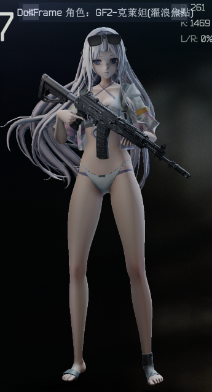

<p align="center">
  
</p>
<p align="center">
  <sub>專案頭像／徽章採用《少女前線》<strong>AK-12</strong> 作為形象圖。</sub>
</p>

<h1 align="center">DollFrame</h1>

<p align="center">
  <strong>面向 Single Player Tushonka 的模組化 PMX 角色替換框架 — 直接讀取 PMX 資料夾、獨立骨架、兩骨手臂 IK、PBR/SDF 著色、次要物理與語音替換。</strong>
</p>

<p align="center">
  <a href="README.md">English</a> |
  <a href="README.zh-TW.md">繁體中文</a> |
  <a href="README.ja.md">日本語</a>
</p>

---

## 版本與平台資訊

<p align="center">
  
  
  
  
</p>

---

## 專案概述與設計理念

**DollFrame** 是專為 [Single Player Tushonka](https://www.sp-tarkov.com/) 開發的 BepInEx 客戶端模組，可於執行期直接載入解包後的 **PMX（MMD）2.0** 角色資料夾（`.pmx` 與貼圖），無需額外封裝專有歸檔格式。DollFrame 會在玩家 `Root_Joint` 下建立獨立的蒙皮骨架（Rig），逐幀鏡射原版動畫姿態，透過兩骨 IK 將雙臂精準重定向至武器握持點，並整合 `.wav` 語音替換、次要物理、自訂 PBR/SDF 著色器與非破壞性裝備隱藏。另附一個選用的伺服端 companion（`DollFrame.Server.dll`），僅用於在 SPT 伺服端啟動時顯示載入資訊。

### 核心設計理念

- **預設零干擾**：`Replace player body` 預設為 `false`。關閉時對戰局與藏身處玩家**零寫入**，動作與視角完全原生，同時主選單 3D 預覽與跳蚤市場角色卡仍可正常預覽。
- **原版骨架零侵入**：不修改 `SkeletonRootJoint` 與 `SkeletonHands` 的變換，不覆寫攝影機與開鏡（ADS）視角。
- **零拉伸契約**：每幀僅寫入 `localRotation`（僅在 Build 期於 rig 根套用一次腿錨定單一等比縮放 `k`），維持作者原始比例不變形。

---

## 功能與特色

- **直接讀取 PMX 2.0 資料夾與等比縮放**：掃描含 `.pmx` 的角色資料夾並於載入期自動拆分頭／身網格，依腿長比例套用單一等比縮放與碰撞膠囊高度補償，並內建 LRU 快取（預設保溫 4 位角色）減少切換卡頓。
- **兩骨手臂 IK 與指尖吸附**：持槍與持物時以兩骨 IK 求解上臂／前臂，搭配胸腔 SDF 防穿模、`< 0.05 cm` 手腕握點收斂，以及漸進式手指吸附收攏，改善指尖微翹問題。
- **自然空手垂臂姿態**：未持武器時自動進入自然微彎垂臂、腕部微屈、五指漸進放鬆及步態擺臂；死亡或進入布娃娃狀態時自動回退純 FK 鏡射。
- **語音替換與響度標準化**：掛鉤 `BaseSpeaker.Init` / `ReplaceVoice` 自動載入對應角色家族的 `.wav` 語音包（`Voices/<角色家族>/<觸發資料夾>/`），切回 `Vanilla (PMC)` 時完整還原原版語音；內建 RMS 響度標準化與軟削波限幅，解決語音偏小聲且不破音。
- **次要物理引擎**：支援頭髮、裙擺、絲帶、衣襬與胸部彈性之嚴格零拉伸物理模擬，含全身膠囊碰撞防穿模（前瀏海固定不動）。
- **自訂 PBR / SDF 渲染**：透過 `dollframe_shaders.bundle` 提供 `DollFrame/CharacterPBR` 著色器（缺失時退回 Unity `Standard`），具備環境自適應邊緣光（Rim Light）、布料／絲襪掠射光澤、SDF 臉部陰影，以及第一人稱頭部自動切換 `ShadowsOnly` 防穿相機。
- **8 槽裝備視覺隱藏與內建配件過濾**：資料級隱藏護甲、戰術背心、背包、頭盔、面罩、眼鏡、耳機與臂章（完整涵蓋 `Dress` 蒙皮裝備）以及背上／腰間未持用武器，不動實際屬性；切換武器時當幀即時同步，確保手中武器不會被誤藏，同時支援隱藏 PMX 模型自帶槍枝／背包材質。
- **遊戲內選單 UI**：於角色屬性「**全般（Overall）**」畫面提供 `DollFrame` ◀ ▶ 切換列（即時掃描新 `.pmx` 資料夾免重啟），並支援主選單 3D 預覽與角色卡頭像渲染。

---

## 遊戲內實際效果



---

## 相容性與依賴

- **[Single Player Tushonka](https://www.sp-tarkov.com/)**：`~4.1.6`
- **BepInEx 5 + 0Harmony**：隨 Single Player Tushonka 內建
- **.NET SDK** *（僅自行編譯原始碼時需要）*：`.NET Standard 2.1`（客戶端）／`.NET 8.0+`（伺服端 companion）

---

## 模組安裝步驟

1. 下載釋出檔案或自行建置專案。
2. 依下表將檔案放置於 Single Player Tushonka 遊戲目錄對應位置：

| 檔案內容 | 遊戲目錄目標路徑 |
|---|---|
| `DollFrame.dll` + `dollframe_shaders.bundle` | `BepInEx/plugins/DollFrame/` |
| 角色資料夾（`<角色名>/*.pmx` 與貼圖） | `BepInEx/plugins/DollFrame/Characters/` |
| 語音包（`<角色家族>/<觸發器>/*.wav`） | `BepInEx/plugins/DollFrame/Voices/` |
| 伺服端 companion（`DollFrame.Server.dll`，選用） | `user/mods/DollFrame/` |

3. 啟動遊戲後，在主選單進入 **角色 → 全般（Overall）** 透過 `DollFrame` 列選擇角色；若要在戰局與藏身處實際替換身體，請按 **F12** 開啟設定將 `Visual → Replace player body` 設為開啟。

---

## 設定項與預設值

設定檔路徑：`BepInEx/config/DollFrame.cfg`（可於遊戲內按 **F12** 即時調整）。

### Scaling / Capsule（縮放與膠囊）

| 設定鍵 | 預設值 | 說明 |
|---|---|---|
| `Apply to own player` | `true` | 對本地玩家骨架套用縮放。 |
| `Height multiplier` | `1.0` | 推導膠囊時對模型原始高度的倍率（`0` 可還原原版 PMC 膠囊）。 |
| `Scale capsule` | `true` | 依縮放後身高補償 `CharacterController` / `CapsuleCollider` 高度與中心。 |

### Visual（視覺與物理）

| 設定鍵 | 預設值 | 說明 |
|---|---|---|
| `Replace player body` | `false` | 戰局／藏身處替換玩家身體；關閉時對戰局玩家零寫入。 |
| `Character` | *(自動)* | 目前選用角色資料夾名稱（F12 視窗隱藏，請於 **Overall** 畫面切換）。 |
| `PMX unit scale` | `0.078` | 每個 PMX 單位對應公尺數（MMD 慣例 `1u ≈ 8 cm`）。 |
| `Model Y offset (m)` | `0` | 模型浮空或略微沉地時的垂直微調。 |
| `Max texture size` | `2048` | 載入時降採樣超過此尺寸的貼圖以節省 VRAM。 |
| `Hide model accessories` | `true` | 隱藏模型作者內建的槍枝／背包等配件材質。 |
| `Hide accessories name filter` | `gun, glock, bag, butt, weapon, silencer` | 不分大小寫的子字串篩選，符合的配件材質將被隱藏。 |
| `Model facing yaw (deg)` | `180` | 相對於玩家正前方的偏航角（PMX 面向 `-Z`，`180` 即朝前）。 |
| `Idle cache size` | `4`（`2–24`） | 已解析角色的 LRU 快取上限；越大切換越流暢但佔用更多 VRAM。 |
| `Replace player voice` | `true` | 自動套用對應角色語音包，切回 `Vanilla (PMC)` 時自動還原。 |
| `Enable secondary physics` | `true` | 啟用頭髮、裙擺、絲帶、衣襬與胸部次要物理及膠囊碰撞。 |
| `Enable rim light` | `true` | 啟用環境自適應邊緣光與布料掠射光澤。 |
| `Rim light intensity` | `0.65`（`0–2.5`） | 邊緣光全域強度倍率（`0` 為關閉）。 |
| `Rim light sharpness` | `3.2`（`0.8–8.0`） | 邊緣光向輪廓邊緣收斂的銳利度。 |
| `Rim light tint` | `(0.85, 0.93, 1.0, 1.0)` | 邊緣光全域色調疊加。 |

### Equipment（裝備視覺隱藏，8 項皆預設 `true`）

| 設定鍵 | 預設值 | 說明 |
|---|---|---|
| `Hide armor on replaced bodies` | `true` | 隱藏護甲外觀（選單／戰局／第一人稱／角色卡）。 |
| `Hide tactical rig on replaced bodies` | `true` | 隱藏戰術背心外觀。 |
| `Hide backpack on replaced bodies` | `true` | 隱藏背包外觀。 |
| `Hide headwear on replaced bodies` | `true` | 隱藏頭盔／頭飾外觀（含 `Dress` 蒙皮件）。 |
| `Hide face cover on replaced bodies` | `true` | 隱藏面罩外觀。 |
| `Hide eyewear on replaced bodies` | `true` | 隱藏眼鏡外觀。 |
| `Hide earpiece on replaced bodies` | `true` | 隱藏耳機外觀。 |
| `Hide armband on replaced bodies` | `true` | 隱藏臂章外觀。 |

---

## 角色包設定說明

- **角色資料夾（`*.pmx`）**：將每個角色的 `.pmx`（PMX 2.0）模型與其貼圖放入獨立子資料夾 `BepInEx/plugins/DollFrame/Characters/<角色名稱>/`（或 `DollFrame_Characters/`）。模組亦會自動掃描 `BepInEx/plugins/` 下其他子資料夾內的 `Characters/`、`DollFrame_Characters/`、`Voices/`、`DollFrame_Voices/`，方便以獨立內容包形式安裝。
- **語音包（`*.wav`）**：請依 `Voices/<角色家族>/<EPhraseTrigger>/*.wav` 目錄結構放置 16-bit PCM 或 32-bit float `.wav` 檔（例如 `OnFight/`、`NeedMedkit/`、`OnBeingHurt/`）。支援最長前綴匹配（例如角色資料夾名為 `AK12_Skin` 會自動對應 `Voices/AK12/`）。

---

## 問題排除

| 常見症狀 | 排查與處理方式 |
|---|---|
| Overall 切換列看不到角色 | 確認角色子資料夾內含 `.pmx` 檔且置於 `BepInEx/plugins/DollFrame/Characters/`（或擴充包對應資料夾）。 |
| 模型稍微浮空或陷地 | 調整 `Visual → Model Y offset (m)` 進行微調。 |
| 切換角色時畫面卡頓 | 調高 `Visual → Idle cache size` 以保留更多已解析角色快取。 |
| 顯示記憶體（VRAM）偏高 | 調低 `Visual → Max texture size`（如 `1024`）或減少 `Idle cache size`。 |
| 語音未生效 | 確認 `Voices/<角色家族>/<EPhraseTrigger>/*.wav` 路徑正確且已開啟 `Replace player voice`。 |
| 缺乏邊緣光或質感異常 | 確認 `dollframe_shaders.bundle` 與 `DollFrame.dll` 同置於 `BepInEx/plugins/DollFrame/`。 |
| 查看模組執行紀錄 | 於 `BepInEx/LogOutput.log` 搜尋 `[DollFrame]` 前綴日誌。 |

---

## 技術架構

```text
Plugin.cs                      # BepInEx 入口：26 項設定綁定、資料夾掃描、Harmony 註冊
├── Character/
│   ├── PmxRuntime.cs          # PMX 2.0 解析、貼圖載入與 PmxAssets LRU 快取
│   ├── MeshSplitter.cs        # 載入期拆分頭／身網格
│   ├── CharacterRig.cs        # Rig 建構與每幀 Drive（僅寫入 localRotation）
│   ├── GameBones.cs           # 遊戲骨骼錨點解析（戰局與預覽共用）
│   ├── BoneContract.cs        # PureDelta / PureRel 骨骼契約與指骨映射
│   ├── ModelMetrics.cs / ModelScaler.cs  # 解剖跨距量測與單一等比縮放
│   ├── Kinematics/            # 純數學模組：TwoBoneIk、ArmGrabIk、ArmRest、RigAim、SpringPhysics
│   ├── ShaderManager.cs / SdfFaceShading.cs  # 著色束載入、邊緣光與臉部 SDF
│   ├── VoiceReplacer.cs       # WAV 載入、RMS 響度標準化與 BaseSpeaker 掛鉤
│   ├── Camera/FirstPersonSMRMask.cs          # 第一人稱頭部 ShadowsOnly 遮罩
│   └── BodyReplacer.cs / Patches.cs / CapsulePatches.cs / IkRefresh.cs
├── Visibility/                # 原版素體隱藏、8 槽裝備隱藏（含 Dress）、內建配件過濾、Vanilla 判準
├── MenuUI/                    # Overall 切換列、主選單 3D 預覽、角色卡頭像
├── Shaders/                   # 預建 dollframe_shaders.bundle
└── ServerMod/                 # 選用 SPT 伺服端載入資訊模組
```

---

## 開發與建置

1. 於 `UserSettings.props` 設定 `SPTTarkovDirectory` 指向遊戲目錄。
2. 常用建置指令：

```bash
# 純驗證建置（不部署至遊戲目錄，應為 0 警告 0 錯誤）
dotnet build -c Release -p:CopyOutputToBepInEx=false

# 建置並自動部署 DollFrame.dll 與 dollframe_shaders.bundle 至 BepInEx/plugins/DollFrame/
dotnet build -c Release

# 建置選用伺服端 companion
dotnet build ServerMod/DollFrame.Server.csproj -c Release
```

---

## 開發進度

- [x] **v0.4.0–0.4.1**：修復藏身處穿過地板問題、全模組生命週期與記憶體洩漏優化、修復頭盔／耳機／面罩未隱藏、修復切換武器誤藏問題、抓取精度 `< 0.05 cm` 與手指吸附、自然空手垂臂姿態、語音 RMS 響度標準化與精簡設定項。
- [ ] **後續規劃**：支援個別角色獨立語音音量／音調預設、擴充更多觸發語音別名與進階風格化著色預設。

---

## 致謝與授權

- **作者**：`kukki`
- **技術基礎**：[Single Player Tushonka](https://www.sp-tarkov.com/)、[BepInEx](https://github.com/BepInEx/BepInEx)、[Harmony](https://github.com/pardeike/Harmony)
- **專案頭像**：使用《少女前線》**AK-12** 作為形象圖。
- **相關文件**：[`CHANGELOG.md`](CHANGELOG.md) · [`AGENTS.md`](AGENTS.md)
- **授權條款**：**All rights reserved** © `kukki`（詳見 [`ServerMod/ModMetadata.cs`](ServerMod/ModMetadata.cs)）。
